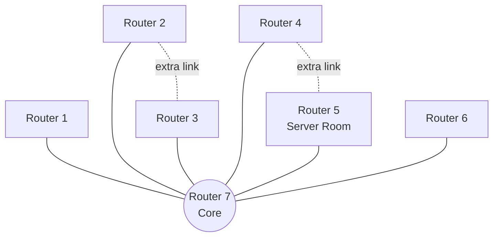

# 🎓 University of Scholars Network


A multi-campus university network simulated in **Cisco Packet Tracer 9.0.0**, built as the CSE405 (Computer Networks) Mini Project at East West University.

---

## 📌 Overview

This project simulates the network of a university with **seven campuses**. Each campus has its own LAN with wired and wireless hosts. The campuses are connected through serial links, and a central server room hosts DHCP, DNS, and web services. The university website is reachable at:

```
http://abc.scholarsbd.edu
```

---

## ✨ Features

- 7 campus LANs (wired + wireless hosts)
- Serial WAN links between routers
- **OSPF** (area 0) on Routers 2, 3, 4, 5, and 7
- **Static routing** on Routers 1 and 6, with static route redistribution into OSPF on Router 7
- Central **DHCP server** with **DHCP relay** (`ip helper-address`) for remote wired campuses
- Local DHCP on wireless routers for wireless clients
- **DNS server** mapping `abc.scholarsbd.edu` to the web server
- **HTTP web server** hosting a multi-page university website
- Use of all three IPv4 address classes (A, B, C)

---

## 🗺️ Topology



> **Note:** The design is a star centered on Router 7, with two additional links (Campus 2 ↔ Campus 3 and Campus 4 ↔ Campus 5) for redundancy.

---

## 🌐 IP Addressing

### Campus LANs

| Campus | Network      | Gateway    | Router | Routing |
|--------|--------------|------------|--------|---------|
| 1      | 10.7.0.0/24  | 10.7.0.1   | R1     | Static  |
| 2      | 10.2.0.0/24  | 10.2.0.1   | R2     | OSPF    |
| 3      | 10.1.0.0/24  | 10.1.0.1   | R3     | OSPF    |
| 4      | 10.4.0.0/24  | 10.4.0.1   | R4     | OSPF    |
| 5      | 10.3.0.0/24  | 10.3.0.1   | R5     | OSPF    |
| 6      | 10.6.0.0/24  | 10.6.0.1   | R6     | Static  |
| 7      | 10.5.0.0/24  | 10.5.0.1   | R7     | OSPF    |

### Serial Links

| Link              | Network         | Endpoints                      |
|-------------------|-----------------|--------------------------------|
| Campus 1 ↔ 7      | 172.16.9.0/24   | R1 `.1` / R7 `.2`              |
| Campus 2 ↔ 7      | 172.16.7.0/24   | R2 `.1` / R7 `.2`              |
| Campus 3 ↔ 7      | 172.16.6.0/24   | R3 `.1` / R7 `.2`              |
| Campus 4 ↔ 7      | 172.16.4.0/24   | R4 `.1` / R7 `.2`              |
| Campus 5 ↔ 7      | 172.16.10.0/24  | R5 `.1` / R7 `.2`              |
| Campus 6 ↔ 7      | 172.16.5.0/24   | R6 `.1` / R7 `.2`              |
| Campus 2 ↔ 3 (extra) | 172.16.1.0/24 | R2 `.1` / R3 `.2`             |
| Campus 4 ↔ 5 (extra) | 172.16.3.0/24 | R4 `.1` / R5 `.2`             |

### Address Classes Used

| Class | Range          | Usage                         |
|-------|----------------|-------------------------------|
| A     | 10.x.x.x       | Campus LANs                   |
| B     | 172.16.x.x     | Serial inter-router links     |
| C     | 192.168.0.0/24 | Wireless LANs (per campus)    |

---

## 🔀 Routing

| Router | Method  | Configuration                                              |
|--------|---------|------------------------------------------------------------|
| R1     | Static  | Default route via `172.16.9.2`                             |
| R6     | Static  | Default route via `172.16.5.2`                             |
| R7     | Static + OSPF | Static routes to `10.7.0.0/24` and `10.6.0.0/24`, redistributed into OSPF with `redistribute static subnets` |
| R2, R3, R4, R5, R7 | OSPF | Process 1, Area 0               |

---

## 🖥️ Server Room (Campus 5)

| Server | IP Address | Role                                   |
|--------|------------|----------------------------------------|
| DHCP   | 10.3.0.2   | Address assignment for wired hosts     |
| DNS    | 10.3.0.3   | Resolves `abc.scholarsbd.edu`          |
| Web    | 10.3.0.4   | Hosts the university website           |

**DNS record:** `abc.scholarsbd.edu` → `10.3.0.4`

### DHCP Design

- **Wired hosts:** Receive addresses from the central DHCP server (one pool per campus). Campuses 1, 2, 3, 4, 6, and 7 use `ip helper-address 10.3.0.2` on their LAN interfaces. Campus 5 is local to the server and needs no relay.
- **Wireless hosts:** Receive addresses from the DHCP service on each campus's wireless router (`192.168.0.0/24`), with DNS set to `10.3.0.3`.

---

## 🌍 Website

The university website is served by the Packet Tracer HTTP server and includes:

- Home page
- Departments
- Admission (undergraduate, graduate, diploma)
- About Us
- Contact form with a simulated confirmation page

> The contact form only navigates to a confirmation page. Packet Tracer has no backend, so messages are not stored or delivered.

---

## ✅ Verification

Connectivity was tested using:

```text
show ip interface brief
show ip route
show running-config
ping <destination>
```

Tests included end-to-end pings between campuses, DHCP lease acquisition by remote wired hosts, DNS resolution, and opening `http://abc.scholarsbd.edu` from a client browser.

---

## ⚠️ Limitations

- Packet Tracer cannot process contact-form submissions.
- Wireless clients use local DHCP rather than the central DHCP server.
- Two extra links were added beyond the star layout.
- Some Packet Tracer behaviors (ARP, DNS, DHCP lease timing) can be intermittent in simulation.

---

## 🛠️ Tools

- Cisco Packet Tracer 9.0.0
- HTML and CSS (web server content)

---

## 👤 Author

**Nurtaz Reza**
Department of Computer Science & Engineering
East West University
Course: CSE405 – Computer Networks (Summer 2026)
Instructor: Dr. Anisur Rahman
